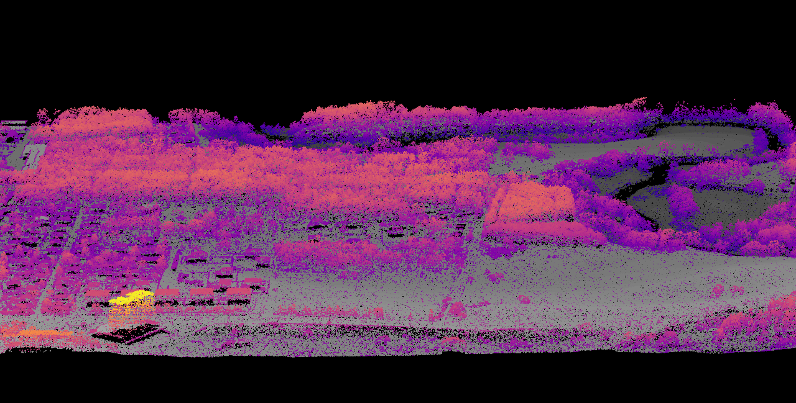

# Day 1 — Points




## Data
Airborne LiDAR point cloud, Estonia (Estonian Land Board), EPSG:3301
Tile 91550_2024, ~4.05M points after cleaning

## Method

Analysis in RStudio using R and the lidR package (v3.1.2).

1. Cleaning — removed noise and water returns (classes 7, 9, 18 — water gives low signal return):

r
las <- filter_poi(las, !Classification %in% c(7L, 9L, 18L))

2. Ground classification — two pmf() (progressive morphological filter) configurations were compared against the reference classification:

| Run | Settings | Ground | Unclassified | Verdict |
|---|---|---|---|---|
| A — single-pass | `pmf(ws = 5, th = 3)` | 2,838,858 | 1,214,287 | Removes large objects, but smaller objects wrongly left in as ground — over-classified |
| **B — progressive** | `ws = seq(3, 12, 3)`, `th = seq(0.1, 1.5, length.out = length(ws))` | **2,401,746** | **1,651,399** | Incrementally removes objects small → large; what's left is the ground. Closer to reference ✓ |

Validated against the reference classification, the progressive run recovered 98% of ground points and cut building misclassification from 77% to 6%.

3. The map — ground points rendered in grey (by elevation), non-ground points — the trees and buildings the progressive filter correctly refused to call ground — glowing on top, coloured by height:

```r
ground    <- filter_ground(las)
nonground <- filter_poi(las, Classification != 2L)

x <- plot(ground, color = "Z", pal = grey.colors(50, start = 0.2, end = 0.7),
          bg = "black", size = 1.5)
plot(nonground, color = "Z", pal = viridis::plasma(50), add = x, size = 1.5)
rgl::snapshot3d("day01_points.png", width = 2000, height = 2000)
```

##### Credits
##### Data: Estonian Land Board · Tools: R, lidR, rgl · #30DayMapChallenge
